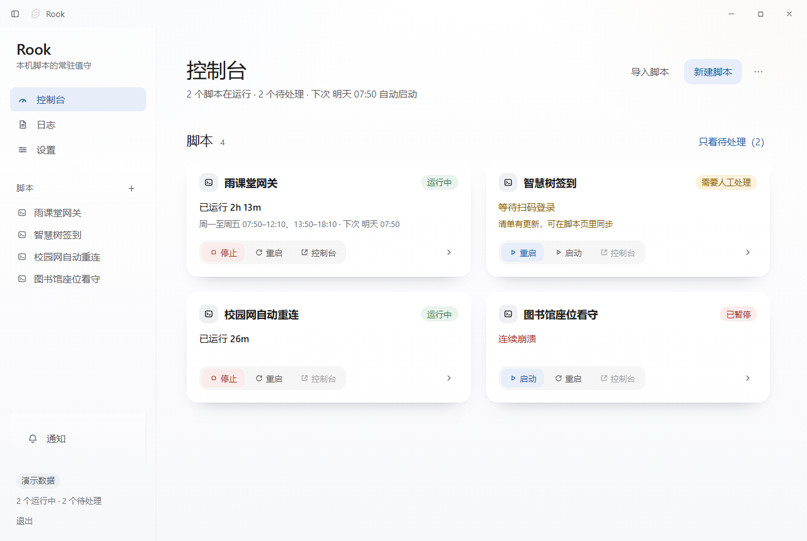
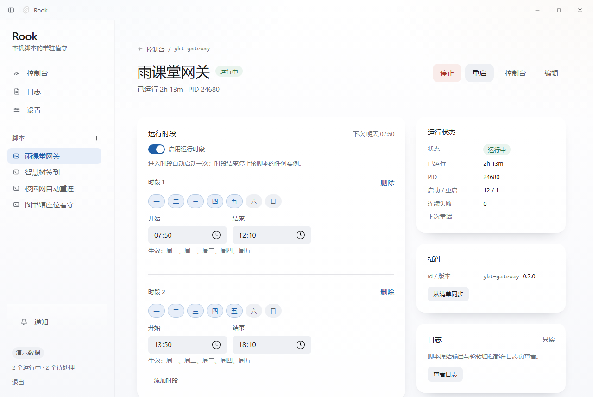
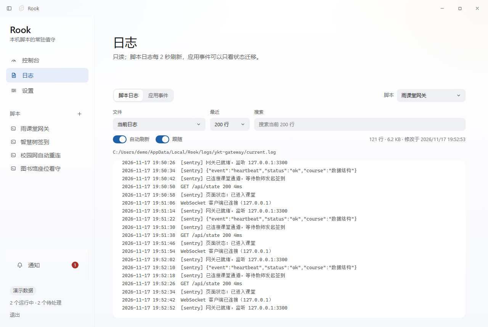
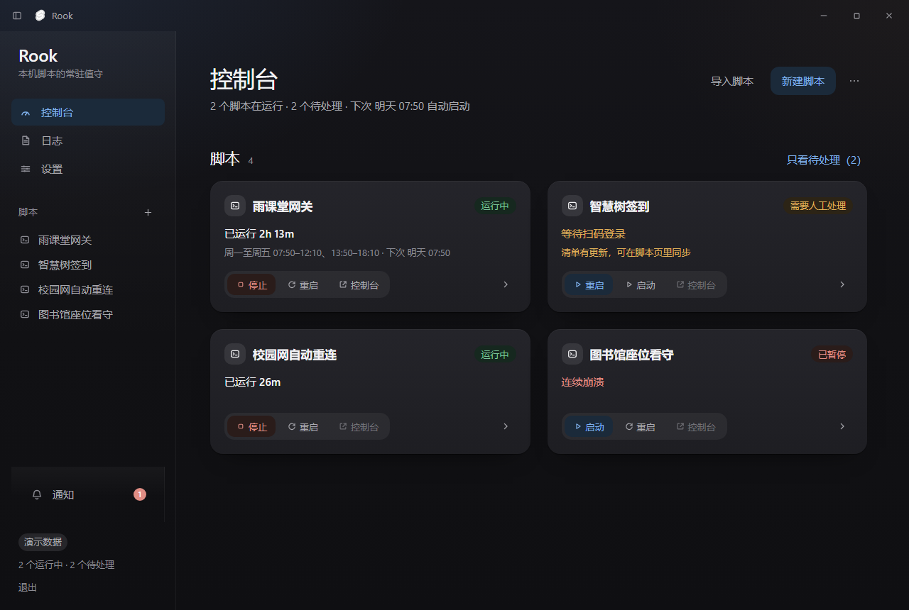
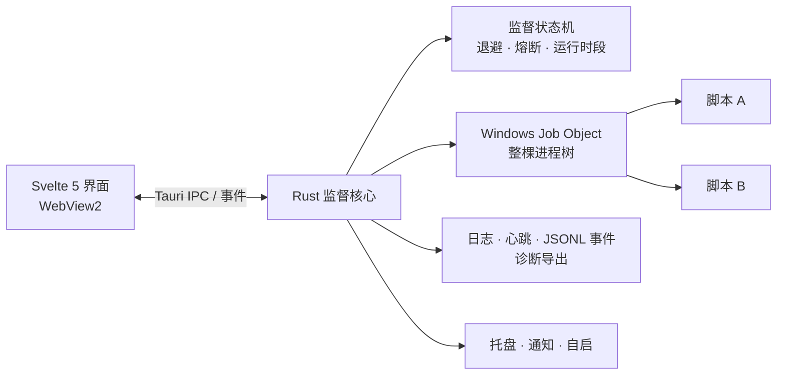

<p align="center">
  
</p>

<h1 align="center">Rook</h1>

<p align="center">
  <strong>本机脚本的常驻值守</strong><br />
  按时拉起 · 崩溃重启 · 健康探测 · 日志留存 · 托盘掌控
</p>

<p align="center">
  
  
  
  
  
  
</p>

<p align="center">
  <a href="#安装">安装</a> ·
  <a href="#快速开始">快速开始</a> ·
  <a href="#第一个任务">第一个任务</a> ·
  <a href="#脚本契约">脚本契约</a> ·
  <a href="#架构">架构</a> ·
  <a href="#已知限制">已知限制</a>
</p>

<p align="center">
  <a href="https://github.com/yuanarcsin/Rook/releases">下载 Release</a> ·
  <a href="CHANGELOG.md">更新日志</a> ·
  <a href="LICENSE">非商业许可</a>
</p>



> Rook（国际象棋里的「车」）是 Windows 托盘里的一名值班员。它不实现任何业务协议，
> 只负责把你的本地脚本按时拉起、看住、重启、记录，并在需要人时提醒你。
> 英文简介：**Rook is a Windows tray supervisor for long-running local scripts.**

---

## 为什么需要它

有些脚本必须长期在线：本地网关、签到助手、网络重连、数据采集、个人机器人……
开着终端时一切正常，没人看着时问题才出现：

- 进程半夜崩了，第二天才发现整晚没工作；
- 开机不会自己起来，或者每次都卡在 UAC；
- 「进程还在」不等于「还在工作」，假活无法识别；
- 日志散落在控制台和临时文件里，出事后没有现场；
- 多个脚本需要不同运行时段和权限，混在一个终端里违反最小权限。

Rook 把这些共性需求收进一个**与领域无关的监督器**：领域逻辑永远留在脚本里，
应用只提供进程生命周期、健康、重启、日志、调度与托盘交互。

## 特性

| 能力 | 说明 |
| --- | --- |
| **进程树监督** | 每个任务实例一个 Windows Job Object；停止、崩溃或应用退出时回收整棵进程树，不误伤其他 `node.exe` / `python.exe`。 |
| **三种健康探测** | `process`（存活）、`heartbeat`（脚本写心跳文件）、`http`（状态码 + 响应体断言）。支持启动宽限、失败阈值与探测超时。 |
| **人工介入状态** | 心跳 `status = login_required / blocked` 或指定退出码可进入 `needs_human`：保留进程、抑制自动重启，只提醒一次。 |
| **智能重启** | 指数退避、随机抖动、连续失败熔断、启动窗口限速；「用户停止」与「异常退出」是两种不同状态。 |
| **运行时段** | 按周配置时段，是任务唯一的时钟与开关：进入窗口自动启动一次，离开窗口无条件停止，休眠唤醒后补算。 |
| **配置即事实源** | 单个 TOML 文件描述全部任务；界面只是可选编辑器。手改文件自动热重载，保存带 revision 冲突检测。 |
| **插件化接入** | 脚本仓库放一份 `rook.plugin.toml` 即可导入为普通任务；后续清单升级用「同步」只覆盖清单拥有的字段。 |
| **可观测性** | 任务 stdout/stderr 按大小/天轮转；核心日志、JSONL 应用事件、心跳文件；一键导出诊断包（敏感键脱敏）。 |
| **托盘与自启** | 单实例、关闭窗口驻留托盘、开机自启（HKCU Run）、状态聚合、通知节流与批量摘要。 |
| **轻量** | Tauri 2 + Rust + 系统 WebView2。安装包约 2.6 MB，主程序约 8.5 MB，不捆绑 Chromium。 |
| **界面** | 控制台卡片、脚本工作区、日志页、设置页；浅色 / 深色 / 跟随系统，侧栏可收起，窗口最小 700×540。 |

## 界面

| 脚本工作区 | 日志 |
| :---: | :---: |
|  |  |

<details>
<summary>深色主题</summary>



</details>

## 安装

### 环境要求

- Windows 10 1809+ / Windows 11 x64
- [Microsoft Edge WebView2 Runtime](https://developer.microsoft.com/microsoft-edge/webview2/)
  （Windows 11 与较新的 Windows 10 已预装；安装器会检查并在缺失时引导安装）

### 安装版（推荐）

从 [Releases](https://github.com/yuanarcsin/Rook/releases) 下载 `Rook_0.1.0_x64-setup.exe`：

- NSIS `currentUser` 安装，**不需要管理员权限**，安装到 `%LOCALAPPDATA%\Rook`；
- 安装器未做代码签名，首次运行可能出现 SmartScreen 提示；校验 `SHA256SUMS.txt` 后再决定是否运行；
- 卸载通过「设置 → 应用」或安装目录的卸载器完成。

### 便携版

下载 `Rook_0.1.0_x64-portable.zip`，解压到任意目录（建议路径不含中文和空格）：

- `Rook.exe` 必须与同目录的 `WebView2Loader.dll` 放在一起；
- 在 exe 同目录放 `Rook.toml` 即使用便携配置，否则回退 `%APPDATA%\Rook\config.toml`；
- 双击启动显示主窗口；关闭窗口后仍驻留托盘，左键托盘图标可重新打开。

### 数据位置

| 形态 | 配置 | 数据 / 日志 |
| --- | --- | --- |
| 安装版 | `%APPDATA%\Rook\config.toml` | `%LOCALAPPDATA%\Rook`（默认） |
| 便携版 | `<exe 同目录>\Rook.toml` 或 `%APPDATA%\Rook\config.toml` | 默认 `%LOCALAPPDATA%\Rook`，可用 `--data-dir` 覆盖 |
| 开发版 | `src-tauri/.dev-data/Rook.toml` | `src-tauri/.dev-data/` |

`[app].data_dir` 可把数据目录改到任意位置；启动期字段（`data_dir`、`watch_config`、
`--config`、`--data-dir`）修改后需要重启，其余配置热重载。

## 快速开始

### 从源码运行

需要：Node.js 22+、pnpm 11+、Rust stable（本项目锁定在 `rust-toolchain.toml`）、
WebView2 Runtime，以及 MSVC Build Tools 或 MinGW 之一。

```powershell
pnpm install
pnpm tauri:dev     # 启动真实桌面应用（数据隔离在 src-tauri/.dev-data/）
```

只改界面时可以不开 Rust：

```powershell
pnpm dev           # 浏览器打开 http://127.0.0.1:1420，使用内存 mock 数据
```

### 构建安装包

```powershell
pnpm tauri build
# 产物：src-tauri/target/release/bundle/nsis/Rook_0.1.0_x64-setup.exe
```

只要便携版（不生成安装器）：

```powershell
pnpm tauri build --no-bundle
# 产物：src-tauri/target/release/Rook.exe（需同目录的 WebView2Loader.dll）
```

### 质量门禁

```powershell
pnpm check         # svelte-check
pnpm test          # Vitest（纯函数与契约）
pnpm build         # 前端静态产物

cd src-tauri
cargo fmt --all --check
cargo clippy --all-targets -- -D warnings
cargo test
```

CI 在 `windows-latest` 上执行同一组门禁，并跑一次 `tauri build --debug --no-bundle`。

## 第一个任务

配置文件默认位于 `%APPDATA%\Rook\config.toml`（便携版为 exe 旁的 `Rook.toml`），
首次启动会自动写入一份带完整注释的模板。最小任务如下：

```toml
version = 2

[[tasks]]
id = "demo"                        # 小写字母/数字/-/_，全局唯一
name = "演示脚本"
command = "node"                   # 裸名称走 PATH，也可写绝对路径
args = ["agent.mjs"]
working_dir = "D:/scripts/demo"    # 必须存在；相对路径相对配置文件
auto_start = true

  [tasks.health]
  type = "heartbeat"
  interval_ms = 5000
  max_age_ms = 30000
  startup_grace_ms = 20000
  needs_human_status = ["login_required", "blocked"]

  [tasks.restart]
  mode = "on-failure"
  max_consecutive_failures = 5

  [tasks.stop]
  method = "graceful"              # 先发 CTRL_BREAK，宽限后强制结束进程树
  grace_ms = 2500
  timeout_ms = 8000
```

保存后配置会自动重载（无需重启），然后在控制台点「启动」。

想按周自动启停，再给任务加一段：

```toml
  [tasks.schedule]
  enabled = true

  [[tasks.schedule.windows]]
  days = ["mon", "tue", "wed", "thu", "fri"]
  start = "07:50"
  end = "18:10"                    # start > end 表示跨午夜
```

启用运行时段后，`auto_start` 不再参与调度：进入窗口自动启动一次，离开窗口停止
该任务的任何实例；窗口外手动启动不受监督器自动行为干预。节假日按自然星期计算，
不做调休日历，也不提供通用 cron。

## 脚本契约

Rook 启动脚本时注入以下环境变量（前缀 `CAMPUS_SENTRY_*` 是稳定的脚本契约）：

| 变量 | 用途 |
| --- | --- |
| `CAMPUS_SENTRY_HEARTBEAT` | 心跳文件绝对路径；未使用心跳探测时也可忽略 |
| `CAMPUS_SENTRY_INSTANCE_ID` | 本次实例 id；写进心跳的 `instance` 字段 |
| `CAMPUS_SENTRY_START_REASON` | 本次启动原因（手动、自启、运行时段、重启等） |
| `CAMPUS_SENTRY_WINDOW_END` | 当前运行时段结束时间（无时段时为空） |

心跳是一个文件里的一行 JSON，建议每 1–5 秒原子替换写入：

```json
{"instance":"8f14e45f-...","seq":42,"ts":"2026-11-17T12:00:00.000Z","status":"ok","detail":"portal online"}
```

- `instance`：取自 `CAMPUS_SENTRY_INSTANCE_ID`，不匹配视为旧实例心跳；
- `seq`：单调递增整数，用于确认「确实在写新内容」；
- `ts`：ISO-8601 时间戳；
- `status`：`ok` / `degraded` / `blocked` / `login_required` 或自定义短字符串；
- `detail`：≤200 字符的人类可读说明。

完整可运行示例见 [`examples/heartbeat-demo/`](examples/heartbeat-demo/)：

```powershell
# 直接运行脚本本体
node examples/heartbeat-demo/agent.mjs

# 或在应用里导入清单
Rook.exe --import-plugin examples/heartbeat-demo/rook.plugin.toml
```

优雅停止默认向进程组发送 `CTRL_BREAK`（Node 里是 `SIGBREAK`，Python 里是
`signal.SIGBREAK`）；脚本可在宽限期内落盘后自行退出，超时则强制回收进程树。
不配合信号的旧脚本可把 `[tasks.stop].method` 设为 `terminate`。

## 插件清单

新脚本不需要改 Rook 代码。在脚本仓库根目录放一份 `rook.plugin.toml`：

```toml
schema = 1

[plugin]
id = "heartbeat-demo"
name = "心跳示例"
version = "1.0.0"
description = "每 2 秒写一次心跳的最小示例。"

[run]
command = "node"
args = ["agent.mjs"]
working_dir = "."
auto_start = false

[health]
type = "heartbeat"
interval_ms = 3000
max_age_ms = 10000
```

在控制台 →「导入脚本」选择清单（或拖入脚本文件夹），预览后导入为普通 `[[tasks]]`，
之后仍可手改或再次同步。清单只描述「怎么启动/探测/展示」，不保存密码；
账号、密钥等静态种子放在任务的 `env` 里，由应用在启动时注入。

## 架构



几条核心取舍：

- **不做 Windows 服务**：监督器运行在当前登录会话，否则无法交互桌面，也不适合
  启动带浏览器/用户配置的脚本；
- **一个任务一个 Job Object**：按进程名或 PID 判断会被共用解释器和 PID 复用坑死；
- **单个 TOML 是唯一事实源**：可读、可 diff、可进版本库，不引入数据库和散落注册表；
- **用户意图是一等状态**：手动停止不会被自动重启覆盖；
- **领域无关**：应用不知道「签到」「校园网」是什么，只认进程、心跳、端口和日志。

### 目录结构

```text
.
├─ src/                    # SvelteKit 前端（控制台、脚本工作区、日志、设置）
├─ src-tauri/              # Rust 监督核心与 Tauri 外壳
│  ├─ src/config/          # 配置模型、校验、热重载、结构化编辑
│  ├─ src/runtime/         # 监督状态机、reconcile、电源与会话
│  ├─ src/process/         # Job Object、启动/停止、端口预检、日志采集
│  ├─ src/health/          # heartbeat / http / process 探测
│  └─ src/commands/        # IPC 命令
├─ examples/heartbeat-demo # 可运行的最小脚本 + 插件清单
├─ assets/                 # README 截图与图标
└─ .github/workflows/      # CI
```

## 已知限制

- **按任务提权未实现**：`elevated` 可配置、可展示，但不会真正提升权限；
- **系统 Toast 依赖开始菜单快捷方式**：AUMID 取自 `<exe 名>.lnk`；快捷方式缺失时
  降级为应用内通知与托盘摘要；
- **仅支持 Windows**（Tauri 外壳本身可移植，但 Job Object、自启、托盘逻辑是 Win32）；
- **自动更新未实现**，安装包**未签名**，首次分发需要校验 SHA256；
- 长时浸泡、不同 DPI / 多显示器 / 权限组合的兼容矩阵仍在补全；
- 运行时段是「每周固定时段」，不是通用 cron，也不处理节假日调休。

## 参与贡献

欢迎 Issue 与 Pull Request。提交前请确保：

1. `pnpm check`、`pnpm test`、`pnpm build` 通过；
2. `cargo fmt --all --check`、`cargo clippy --all-targets -- -D warnings`、`cargo test` 通过；
3. 行为变更同步更新 README 或 CHANGELOG；
4. 不提交本机路径、真实账号、Cookie、token 与运行数据。

## License

本项目采用 [PolyForm Noncommercial License 1.0.0](LICENSE)：源码可见、可修改、可分发，
但**仅限非商业用途**。

- 允许：个人学习、研究、实验、业余项目；慈善组织、教育机构、公共研究机构、
  公共安全/卫生、环保组织与政府机构的使用。
- 需要单独授权：以商业利益为目的的使用，包括公司业务中的生产使用、对外收费服务、
  将本软件作为商业产品的一部分分发等。
- 提交 Pull Request 即表示同意以本项目许可证发布你的贡献。

> 严格来说，这不是 OSI 认可的「开源」许可证，而是 **source-available（源码可见）** 许可。
> 如需商业授权，请通过 [Issues](https://github.com/yuanarcsin/Rook/issues) 联系维护者。

Rook 的名字来自国际象棋的「车」：守一条直线，不越界，也不缺席。
